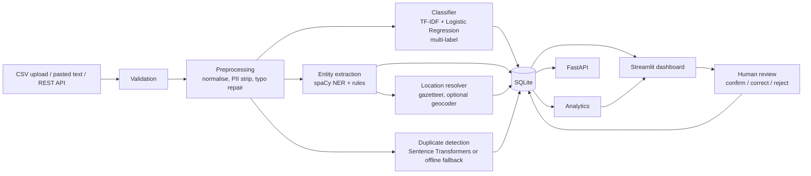
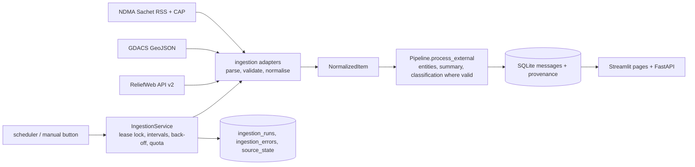

# Architecture



```
                +----------------------------+
 Reports -----> |  nlp/pipeline.py           |  analyze()  ingest()  ingest_dataframe()
 (CSV, text,    |   preprocessing            |
  REST)         |   classifier   entities    |      +--------------+
                |   locations    duplicates  | ---> | SQLite       |  messages, entities,
                +----------------------------+      | database/    |  classifications,
                       ^                |           +--------------+  duplicate_suggestions,
                       |                |                  |          reviews, model_evaluations
        artifacts/ (model, metrics)     |                  v
                                        |        analytics.py (shared)
                                        v                  |
                         api/main.py (FastAPI)       app.py (Streamlit, 9 pages)
```

Principles: original text is never modified; every extracted field carries evidence; unknowns stay "Unknown";
duplicates are suggestions only; humans can correct labels and locations; the core app needs no internet.

The dashboard calls the pipeline directly (no HTTP hop) so it keeps working if the API is not running;
both share the same SQLite file.


## v2: ingestion layer

Imported items live in the existing `messages` table (new provenance columns), so review, duplicates, NLP analysis and analytics keep working.
